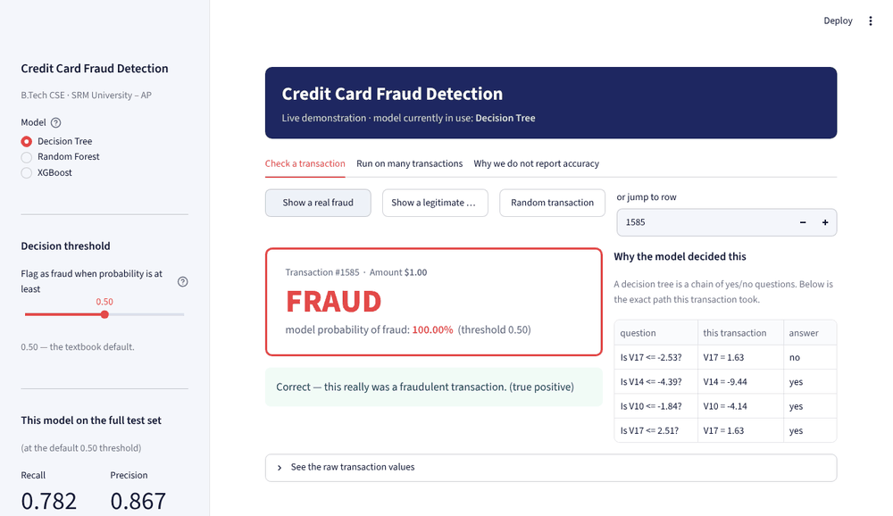

# How To Run This Project

Everything needed to get the project running from a clean machine, in order.
If something breaks, the [Troubleshooting](#troubleshooting) section at the
bottom covers every problem we actually hit while building this.

---

## What you need first

| | |
|---|---|
| Python | 3.10 or newer |
| Disk space | about 400 MB (the dataset is 145 MB) |
| Internet | needed once, to download the dataset and the packages |
| Time | about 10 minutes the first time, 10 seconds every time after |

Check your Python:

```bash
python3 --version
```

---

## Step 1 — Get the code

```bash
git clone https://github.com/lakshay8toic/Credit-Card-Fraud-Detection.git
cd Credit-Card-Fraud-Detection
```

If you already have the folder, just open it:

```bash
cd ~/Programming/Credit-Card-Fraud-Detection
```

> **Nearly every problem is being in the wrong folder.** Run `pwd` — it must
> end in `Credit-Card-Fraud-Detection`. If `pip install -r requirements.txt`
> says *"No such file or directory"*, this is why.

---

## Step 2 — Install the packages

```bash
pip3 install -r requirements.txt -r Demo/requirements.txt
```

That installs NumPy, Pandas, scikit-learn, XGBoost, Matplotlib, Jupyter, and
Streamlit.

**On an Apple Silicon Mac you also need one more thing**, or XGBoost will not
load:

```bash
brew install libomp
```

XGBoost's Mac build depends on Apple's OpenMP runtime, which cannot be shipped
inside the Python package. See [Troubleshooting](#troubleshooting) if `brew`
gives you an architecture error.

---

## Step 3 — Get the dataset

The dataset is 145 MB, which is over GitHub's file size limit, so it is not in
this repository. Download it once:

1. Go to <https://www.kaggle.com/datasets/mlg-ulb/creditcardfraud>
2. Sign in and click **Download**
3. Unzip it and put `creditcard.csv` into the `Dataset/` folder

Check it worked:

```bash
python3 -c "import pandas as pd; d=pd.read_csv('Dataset/creditcard.csv'); print(d.shape, int(d.Class.sum()))"
```

Expected output:

```
(284807, 31) 492
```

If you get those two numbers, the data is correct and complete.

---

## Step 4 — Train the demo models

```bash
python3 Demo/build_demo.py
```

This takes about 45 seconds. It trains three models on the same train/test
split the notebooks use (random seed 77) and saves them so the app can load
them instantly instead of training every time it starts.

**Check the numbers it prints.** They should be:

```
Decision Tree    recall 0.782   precision 0.867   F1 0.822   PR-AUC 0.807
Random Forest    recall 0.725   precision 0.972   F1 0.831   PR-AUC 0.867
XGBoost          recall 0.817   precision 0.951   F1 0.879   PR-AUC 0.876
```

These are the figures in the project report. If yours match, your environment
is reproducing the project correctly.

> XGBoost may come out at precision 0.943 / F1 0.875 instead, depending on
> which XGBoost version you have. That is one extra false alarm out of 85,118
> transactions and is expected — see
> [How To Explain](../How%20To%20Explain/README.md) for the one-line answer.

---

## Step 5 — Run the demo

```bash
streamlit run Demo/app.py
```

It opens automatically at <http://localhost:8501>.

**What you should see:** three models in the sidebar with XGBoost selected, and
*Caught 116 of 142 frauds · 6 false alarms* underneath.



To stop it, press **Ctrl + C** in the terminal.

---

## Running the notebooks instead

The demo is the finished product. The notebooks are the working.

```bash
jupyter notebook Code/
```

Run them **in order, 01 through 10**. Notebook 10 reads result files written by
the earlier notebooks into `Results/tables/`, so it will not work on its own.
Notebooks 02 and 09 live in `Code/Extras/` and can be run at any point.

Every notebook imports `Code/utils.py`, which holds the single data loader, the
single train/test split and the single set of metrics. That shared file is the
reason the comparison between models is fair.

---

## Troubleshooting

### `No such file or directory: 'requirements.txt'`

You are not in the project folder. Run `pwd` and `cd` into
`Credit-Card-Fraud-Detection`.

### `Error: Invalid value: File does not exist: Demo/app.py`

Same cause. `cd` into the project folder first.

### `XGBoostError: Library (libxgboost.dylib) could not be loaded ... libomp.dylib`

XGBoost needs Apple's OpenMP runtime.

```bash
brew install libomp
```

Then restart the app. The other two models keep working without it — the app
shows a warning instead of crashing.

### `brew install libomp` fails with "missing compatible architecture ... need 'x86_64'"

Your Homebrew is the Intel build running under Rosetta, but your Mac is Apple
Silicon, so there is no Intel compiler for it to build with. Homebrew also
dropped Intel support in September 2026, so it cannot fetch a prebuilt copy
either.

Install the native Apple Silicon Homebrew, which coexists with the one you
have:

```bash
arch -arm64 /bin/bash -c "$(curl -fsSL https://raw.githubusercontent.com/Homebrew/install/HEAD/install.sh)"
/opt/homebrew/bin/brew install libomp
```

It must report that it is installing to **`/opt/homebrew`**. That is where
XGBoost looks. The install takes seconds because it downloads a prebuilt
bottle rather than compiling.

### `InconsistentVersionWarning: Trying to unpickle estimator ... from version X when using version Y`

The saved models were trained with a different scikit-learn than you have.
Rebuild them with yours:

```bash
python3 Demo/build_demo.py --retrain
```

### `Demo files are missing. Run python Demo/build_demo.py`

Step 4 has not been run, or `Demo/models/` was deleted. Run it.

### `ERROR: Could not find creditcard.csv`

Step 3 has not been done. The file must be at `Dataset/creditcard.csv`
exactly — not in a subfolder, and not still zipped.

### Port 8501 already in use

An earlier copy of the app is still running. Either use a different port:

```bash
streamlit run Demo/app.py --server.port 8502
```

or stop the old one:

```bash
pkill -f "streamlit run"
```

### The app opens but the text is tiny on a projector

Press **Cmd +** (or **Ctrl +**) in the browser two or three times. Do this
before you present, not during.

---

## What gets created, and what is ignored

`Demo/models/`, `Demo/data/` and `Dataset/creditcard.csv` are generated on your
machine and deliberately **not** committed — they are large and reproducible.
Everything else in the repository is tracked. This is why a fresh clone needs
steps 3 and 4 before step 5 will work.
