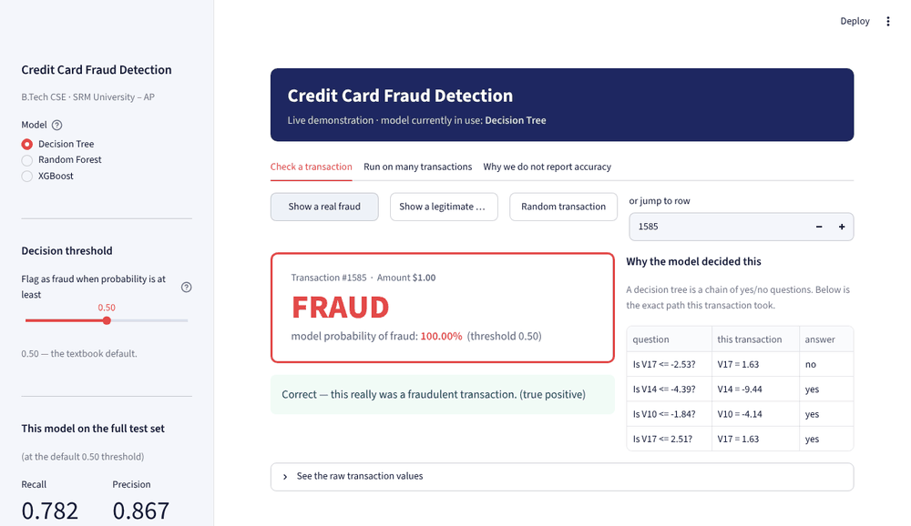

# Start Here

A map of this repository. Two folders answer the two questions people usually
have.

| I want to… | Go to |
|---|---|
| **run the project** on my machine | [`How To Run/`](How%20To%20Run/) |
| **understand and explain** the project | [`How To Explain/`](How%20To%20Explain/) |

---

## What the project does

It decides whether a credit card transaction is fraudulent. The difficulty is
not the decision itself — it is that fraud is only **0.17%** of the data.

> A model that answers "legitimate" for every single transaction scores
> **99.83% accuracy** and catches **zero** fraud.

That one fact drives every choice here: it is why accuracy is never reported,
why recall and precision are used instead, and why the decision threshold is
chosen from cost rather than left at 0.5.

---

## The fastest way to see it working

```bash
pip install -r requirements.txt -r Demo/requirements.txt
# put creditcard.csv into Dataset/   (see Dataset/README.md)
python Demo/build_demo.py        # trains and saves the models, ~45 seconds
streamlit run Demo/app.py        # opens the demo in your browser
```

Full instructions, including every error we hit and how to fix it, are in
[`How To Run/`](How%20To%20Run/).



---

## Where everything lives

```
Code/              8 core notebooks + utils.py (the shared split and metrics)
Code/Extras/       2 supporting analyses (feature reduction, clustering)
Demo/              the live demonstration app
Dataset/           where creditcard.csv goes (not committed, 145 MB)
How To Run/        setup, step by step, with troubleshooting
How To Explain/    what to say about the project, and the likely questions
Report/            the project report
Presentation/      the slide deck
Project Proposal/  the proposal
Results/           every figure, table and screenshot the project produced
```

`Code/utils.py` is the reason the comparison is fair: it holds the single data
loader, the single train/test split and the single set of metrics, so every
notebook is measured the same way.

---

## The six notebooks that matter

Read these in order; together they are the whole project.

| # | Notebook | What it proves |
|---|---|---|
| 01 | Data Exploration and Preprocessing | 473 frauds in 283,726 transactions — and why that breaks accuracy |
| 03 | Decision Tree Learning (ID3) | A model whose every decision can be read as a rule |
| 04 | K-Nearest Neighbour | Performance falls as irrelevant features are added |
| 05 | Naive Bayes and Bayes Optimal Decisions | Where the threshold should sit once cost is known |
| 08 | Ensemble Learning | Many weak models beat one strong model |
| 10 | Model Comparison and Results | The final ranking, and that it holds under cross validation |

Notebooks 06 (SVM) and 07 (Neural Networks) cover Units III and IV. Notebooks
02 and 09 are supporting analyses and live in `Code/Extras/`.

---

## Results

| Model | Recall | Precision | F1 | Frauds caught | False alarms |
|---|---|---|---|---|---|
| Decision Tree | 0.782 | 0.867 | 0.822 | 111 / 142 | 17 |
| Random Forest | 0.725 | 0.972 | 0.831 | 103 / 142 | 3 |
| **XGBoost** | **0.817** | **0.951** | **0.879** | **116 / 142** | **6** |
| Always "legitimate" | 0.000 | 0.000 | 0.000 | 0 / 142 | 0 |

Measured on the full held-out test set of 85,118 transactions, random seed 77.
The full comparison across all twelve models is in notebook 10 and in the
report.
